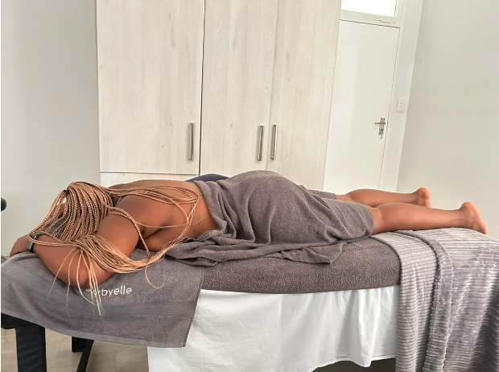
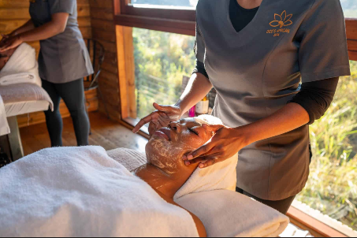
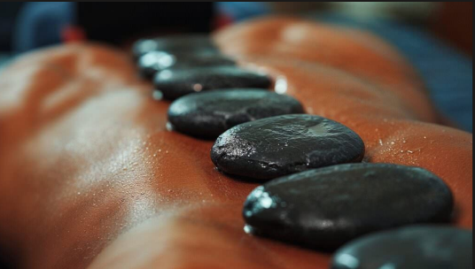

# Pabii's Retreat - Web Development Project Proposal

## Student Information
- **Full Name:** Paballo Mary Mokoena
- **Student Number:** ST10501151
- **Module:** Web Development (DNM0601)
- **Group:** Group One
---

## Project Description

Pabii’s Retreat is a wellness and massage website that is designed to provide customers/clients useful information about the business, available services we offer, packages we have, gallery, customer review, enquiries, and contact details.

### 3.1 Organisation Overview
Pabii’s Retreat was founded by Paballo in July 2026, was created and dedicated with the vision of helping clients to restore their balance, relieve stress and improve their overall health. It was established to deliver the needs of clients after the recognition that a lot of people suffer from stress, fatigue, muscle tension and the pressure of life. The Retreat will ensure that it offers different range of therapeutic services that will include hot stone therapy, facial treatment, Swedish massage, full body massage and more. 

Main reason of establishing Pabii’s Retreat was to provide affordable, high-quality services to motivate people to prioritise their health, promote their physical and mental wellness in a calm and comfortable environment.

---

**The website will therefore contain the following main pages:**
* Homepage
* About Us
* Services
* Packages
* Gallery
* Customer Reviews
* Enquiries
* Contact Us

---

### 4.1 Sitemap - Pabii’s Retreat
The sitemap provides visitors with access to information about the organization, wellness services, the packages, gallery, enquiries, customer reviews and contact information.

The provided structure helps customers find suitable treatments, be able to have a refreshing environment and make enquiries or spa bookings efficiently.

---
# Key Features and Functionality
* **Multi-Page Structure:** Dedicated pages for Home, About Us, Services, Packages, Gallery, Customer Reviews, Enquiries, and Contact Us.
* **Responsive Layout:** Adaptive desktop, tablet, and mobile layouts built using CSS Grid, and media queries.
* **Interactive Forms:** Functional enquiry form with deposit/booking policy details and a direct contact form.
* **CSS Visual Styling:** Modern aesthetic featuring a custom color scheme, typography scales, pseudo-classes (`:hover`, `:focus`, `:active`), and layout structures.
---

## PABII’S RETREAT PAGES

### 1. Homepage - `index.html`
* **Welcome to Pabii’s Retreat**
* *Unwind. Regroup. Reconnect. Renewed.*
* Our retreat spa offers personalized treatment and therapeutic treatment for its customers to be able to unwind, calm their minds, relax their bodies, be flexible and mostly have a healthy lifestyle.

### 2. About Us - `about.html`
Pabii’s Retreat is a customised spa and therapeutic treatment that provides its clients a personalised wellness experience that is designed to remove them from everyday life and promotes relaxation and improving long lasting wellness.

* **Mission:** We aim to provide exceptional and personalised therapy that calms the mind, relax the body, lift the spirit and mostly create a lasting sense of well-being to our clients.
* **Vision:** Our aim is to become a respected, leading and reputable wellness centre of excellence by providing high-quality relaxation and therapeutic services.

### 3. Services / Packages - `services.html`
**Packages include:**
* **Package A:** Welcome juice, 45 mins Full Body Massage, Lunch and coffee/juice — all this luxury for **R600**.
* **Package B:** Welcome juice, Facial Treatment, 30 mins Full Body Massage, 15 mins backstone therapy, 15 mins facial treatment — all for **R350**.
* **NB:** Additional services to offer.

### 4. Package Details - `packages.html`
*(Reference to promotional Canva layout image showing Package 1, Package 2, and pricing details)*.

### 5. Gallery - `gallery.html`
Visual media displaying spa rooms, treatment procedures, and relaxing environments.

### 6. Enquiry - `enquiry.html`
Complete the form below to enquire about our services or request a spa appointment. Our team will respond with availability and further information.

* **Booking Policies:** 
  * Required non-refundable deposit of 30% to confirm your appointment.
  * Late fee required after 30 minutes grace period.

**Enquiry form fields:**
* **Personal information:** Full Name, Email Address, Phone Number.
* **Appointment information:** Preferred Date, Preferred Time, Preferred Treatment, Number of People.
* **Additional requirements:** Special requests, Questions, Preferred therapist (if applicable).

### 7. Contact Us – `contact.html`
* **Phone:** 061 232 6031.
* **Email:** pabii’s@retreatspa.co.za.
* **Address:** 195/11907 Msilinga Street, Pimville Zone 9, 1809.
* **Business hours:** 
  * Monday – Friday: 9am – 6pm.
  * Saturday: 8am – 1pm.
  * Sundays: Closed.
  * Public holidays: Open upon request.
* **Contact form fields:** Full Name, Email, Phone, Subject, Message, Submit button.

### 8. Customer Reviews - `reviews.html`
As Pabii’s Retreat is a new business that started operating in July, it doesn’t currently have existing customer reviews yet as we are still promoting the business using family and friends.

### 9. Social Media
As Pabii’s Retreat is a newly formed business it hasn’t yet established social media channels since it was launched in July 2026. Social media has been spoken about as an important marketing platform. This platform will assist in promoting Pabii’s Retreat, showcase our services and packages, share wellness content, engage with customers, and attract new clients.

---

## Content Research and Sourcing

* **Organization’s Website:** Pabii’s Retreat was established in July 2026 as a new business, it currently has limited web history as we were using WhatsApp to promote the business to our friends, family and close neighbor's. The proposed website will be established to attract customers and provide them with important information about the Retreat. 
* **Social Media:** As a newly formed business, social media has been identified as a critical future marketing platform to assist in promoting the business.
* **Public Domain and Creative Commons Resources:** Pabii’s Retreat will use public domain and creative resources suitable for the organization that display elements such as wellness and nature

---
## Timeline and Milestones
- **Phase 1:** Research, Sitemap Planning, and Proposal Submission.
- **Phase 2:** HTML Structure Implementation and GitHub Version Control.
- **Phase 3:** CSS Styling, Responsive Design, and Testing.

---
## Sitemap
- **Homepage:** `index.html`
- **About Us:** `about.html`
- **Services:** `services.html`
- **Packages:** `packages.html`
- **Gallery:** `gallery.html`
- **Enquiry:** `enquiry.html`
- **Contact Us:** `contact.html`
- **Reviews:** `reviews.html

---
## Part 1 Details
- Initial Sitemap creation and content research complete.
- Basic HTML structure set up across main pages.
- Repository set up and initial files committed.

---

## Future Improvements 
Future improvements to the website may include:
* Implementing customer reviews and testimonials pages.
* Adding social media links.
* Improving by implementing an online booking system.
* Showcase more treatment photographs.
* Having more package options.
* Improving accessibility and mobile responsiveness.
* Introducting an online payment option.
* Updating services and prices when required.

---
## Part 2 Details (CSS and Responsive Design)
* **External Stylesheet:** Styled using `css/style.css` with baseline typography, custom color palette, and CSS reset rules.
* **Layout Techniques:** Flexible layout structures implemented using CSS Grid for multi-column alignment.
* **Breakpoints and Media Queries:** Customized media queries targeting desktop, tablet, and mobile viewports. 

### Responsive Design Evidence
* **Desktop View:**
  
 

* **Tablet View:**
  
  . 

* **Mobile View:**
  
 

---
### Part 1 Feedback Implementation and Corrections
* **[09 September 2026]:** **HTML File Paths** — Corrected file naming and relative link paths across all navigation menus to ensure seamless page transitions.
* **[11 September 2026]:** **Semantic Markup** — Updated HTML structure to include semantic layout elements (`<header>`, `<nav>`, `<main>`, `<section>`, `<footer>`).
* **[12 September 2026]:** **Form Controls** — Added appropriate field for both the enquiry form and contact us.

### Part 2 Feature Additions (CSS and Responsive Design)
* **[14 September 2026]:** **Stylesheet Integration** — Created external stylesheet `css/style.css` and linked all pages.
* **[14 September 2026]:** **Base Styling and Typography** — Defined typography scaling (`rem`/`em`), baseline margins, paddings, and CSS resets.
* **[15 September 2026]:** **Layout Implementation** — Built multi-column card layouts using  CSS Grid for desktop screens.
* **[16 September 2026]:** **Media Queries** — Added responsive breakpoints converting desktop grid layouts into single-column flows for tablet and mobile devices.
* **[16 September 2026]:** **Interactive States** — Added hover and active focus states to buttons, navigation elements, and form inputs.

---

### Changelog - Pabii's Retreat Project

## Project Initialization and Proposal
* **[10 July 2026]:** Established Pabii’s Retreat as a new wellness business launched in July 2026.
* **[10 July 2026]:**  Create project documentation and defined the objectives of the organisation and stated the affordability therapeutic services, stress relief, and physical wellbeing.

### New Additions and Feature Updates 
* **[02 August 2026]:** Added dedicated area for customers feedback, testimonials, and highlighting reviews are increasing as family and friends try the treatment.
* **[02 August 2026]:** Added a social media planning to describe the plans, engagement activities, shows their services and strategies to attract more clients.
* **[02 August 2026]:** Added a roadmap for future improvements that will be dealing with plans for booking systems, secure payments options, mobile accessibility enhancement, and expanded package.

### Part 1&2
Changelog - Pabii's Retreat 

* **[10 July 2026]:**- Project Initialization & Scope 
* **[10 July 2026]:** Established Pabii’s Retreat as a new wellness business launched in July 2026. 
* **[10 July 2026]:** Create project documentation and defined the objectives of the organisation and stated the affordability therapeutic services, stress relief, and physical wellbeing 

* **[25 July 2026]:**  Research & Sitemap Planning 
* **[25 July 2026]:** Completed initial sitemap structure and content sourcing for core HTML pages. 
* **[25 July 2026]:** Gathered public domain assets and drafted treatment package descriptions. 

* **[02 August 2026]:** Part 1 Deliverables & Feature Additions
* **[02 August 2026]:** Added dedicated area for customers feedback, testimonials, and highlighting reviews are increasing as family and friends try the treatments. 
* **[02 August 2026]:** Added a social media planning to describe the plans, engagement activities, shows their services and strategies to attract more clients. 
* **[02 August 2026]:** Added a roadmap for future improvements that will be dealing with plans for booking systems, secure payments options, mobile accessibility enhancements, and expanded package. 

* **[09 September 2026]:**  Feedback Corrections & HTML Refinement 
* **[09 September 2026]:** Standardized file paths and corrected relative links across site navigation. 
* **[09 September 2026]:** Improved layout markup to semantic HTML5 tags (<header>, <nav>, <main>, <section>, <footer>). 
* **[09 September 2026]:** Enhanced form inputs for both the enquiry form and contact page. 

* **[14 September 2026]:**  Part 2 CSS Styling & Layout Implementation 
* **[14 September 2026]:** Created external stylesheet css/style.css and connected all pages. 
* **[14 September 2026]:** Added CSS reset rules, typography scales (rem), and primary/accent colour variables. 
* **[14 September 2026]:** Developed multi-column card layouts using CSS Grid for service/package sections. 

* **[16 September 2026]:** Responsive Breakpoints & Final Verification 
* **[16 September 2026]:** Added custom @media queries targeting different screen sizes. 
* **[16 September 2026]:** Tested cross-browser to Google Chrome, and Microsoft Edge. 
* **[16 September 2026]:** Defined a responsive breakpoint for different screen size. 

### Part 3 JavaScript Enhancement
## 1. Changes applied to every page
* **[21 October 2026]:** Site-wide search bar added to the header (all 8 pages) with a screen-reader label and live results area.
* **[21 October 2026]:** Scripts linked before </body>: js/search-index.js and js/main.js (search, lightbox, form validation).
* **[21 October2026]:** Centred page margin via css/style.css: page column up to 1280px, centred with equal side margins; content centred at 1100px.
* **[21 October 2026]:** lightbox applied automatically to every image inside <main> (the logo in the header is excluded).
* **[21 October 2026]:** Layout fixes: horizontal navigation bar on desktop, card/grid styles, buttons, form styling, responsive
breakpoints at 900px and 650px.

## 2. Page by page
index.html – Home
* **[21 October 2026]:** Search bar added to header; scripts linked.
* **[21 October 2026]:** Hero image, service cards, "why choose us" blocks and buttons now styled and centred (CSS only).
* **[21 October 2026]:** Service images open in the lightbox.

about.html – About Us
* **[21 October 2026]:** Search bar added to header; scripts linked.
* **[21 October 2026]:** Facial treatment image opens in the lightbox; "What We Offer" cards laid out in a grid

services.html – Services
* **[21 October 2026]:** Search bar added to header; scripts linked.
* **[21 October 2026]:** Fixed 6 broken links: enquires.html → enquiry.html (4 "Enquire Now" buttons plus 2 further
links).
* **[21 October 2026]:** Corrected alt text on the facial image (was "Hot stone therapy").
* **[21 October 2026]:** All four service images open in the lightbox; cards laid out in a two-column grid.

packages.html Packages
* **[22 October 2026]:** Replaced the duplicated, nested <header> and unstyled link list with the standard site header and
navigation, so the search bar and mobile menu now work on this page. 
* **[22 October 2026]:** Fixed broken links: enquires.html → enquiry.html (5 links)
* **[22 October 2026]:** Scripts linked.

gallery.html – Gallery
* **[22 October 2026]:** Search bar added; scripts linked.
* **[22 October 2026]:** Removed stray <link rel="stylesheet"> placed inside the logo container.
* **[22 October 2026]:** Added the missing closing 
 for gallery-grid.
* **[22 October 2026]:** Removed duplicated headings and typos ("Full Body Message", "Foot Message", "Facials", "Pool Lunch", "Pool Pic", "Bed Area" appeared twice or above the image).
* **[22 October 2026]:** Corrected alt text: full body massage image (was "Facial treatment"); "Pabi's" → "Pabii's" on Pool Pic and Bed Area.
* **[22 October 2026]:** Added missing headings for Pool Pic and Bed Area; replaced the copied caption on Bed Area with "A
calm treatment room with comfortable massage beds."
* **[22 October 2026]:** Lightbox: all 7 images open large with previous/next, zoom and scroll.

enquiry.html – Enquiry
* **[22 October 2026]:** Search bar added; scripts linked.
* **[22 October 2026]:** Form marked data-form="enquiry". JavaScript validates required fields, email, South African phone
format, past dates and guest numbers, showing inline error messages.
* **[22 October 2026]:** On a valid submit the page shows an estimated cost and availability message without reloading
(including a Sunday-closed notice)

contact.html – Contact Us
* **[22 October 2026]:** Search bar added; scripts linked.
* **[22 October 2026]:** Form marked data-form="contact"; same validation as above. On a valid submit the message is compiled into an email to the Retreat's address.
* **[22 October 2026]:** Fixed broken HTML comment (<-- … -->).
* **[22 October 2026]:** Map section now shows two locations: the Retreat (existing embed) and the nearby Maponya Mall, each with an accessible title

reviews.html – Reviews
* **[22 October 2026]:** Search bar added; scripts linked.
* **[22 October 2026]:** Fixed broken link enquires.html → enquiry.html.
* **[22 October 2026]:** Review form now validated by the shared script.

---

## References
* American Massage Therapy Association (AMTA), 2024. *Massage Therapy Research and Consumer Information*. [online] Available at: <https://www.amtamassage.org/> [Accessed 25 July 2026].
* Creative Commons, 2026. *Sharing Openly, Sharing Globally*. [online] Available at: <https://creativecommons.org/> [Accessed 02 August 2026].
* Creative Commons, 2026. *Attribution*. [online] Available at: <https://creativecommons.org/licenses/> [Accessed 02 August 2026].
* Sharpsheets, 2026. *SWOT Analysis for a Massage Therapy Business*. [online] Available at: <https://sharpsheets.io/blog/swot-analysis-massage-therapy-business/> [Accessed 25 July 2026].
* Mozilla,2026 . CSS media queries. [online] Available at: <https://developer.mozilla.org/en-US/docs/Web/CSS/Guides/Media_queries> [Accessed 21 October 2026].
* Mozilla,2026. Constraint validation. [online] Available at: <https://developer.mozilla.org/en-US/docs/Web/HTML/Guides/Constraint_validation> [Accessed 22 October 2026].
* Mozilla, 2026. JavaScript guide. [online] Available at: <https://developer.mozilla.org/en-US/docs/Web/JavaScript/Guide> [Accessed 21 October 2026].
* Mozilla, 2026. Responsive web design. [online] Available at: <https://developer.mozilla.org/en-US/docs/Learn_web_development/Core/CSS_layout/Responsive_Design> [Accessed 21 October 2026].
* World Health Organization (WHO), 2026. *Self-care for Health and Well-being*. [online] Available at: <https://www.who.int/> [Accessed 02 August 2026].
* World Wide Web Consortium (W3C), 2026. Images tutorial. [online] Available at: <https://www.w3.org/WAI/tutorials/images/>(https://www.w3.org/WAI/tutorials/images/) [Accessed 22 October 2026].
* World Wide Web Consortium (W3C), 2026. Page structure tutorial. [online] Available at: <https://www.w3.org/WAI/tutorials/page-structure/> [Accessed 22 October 2026].
